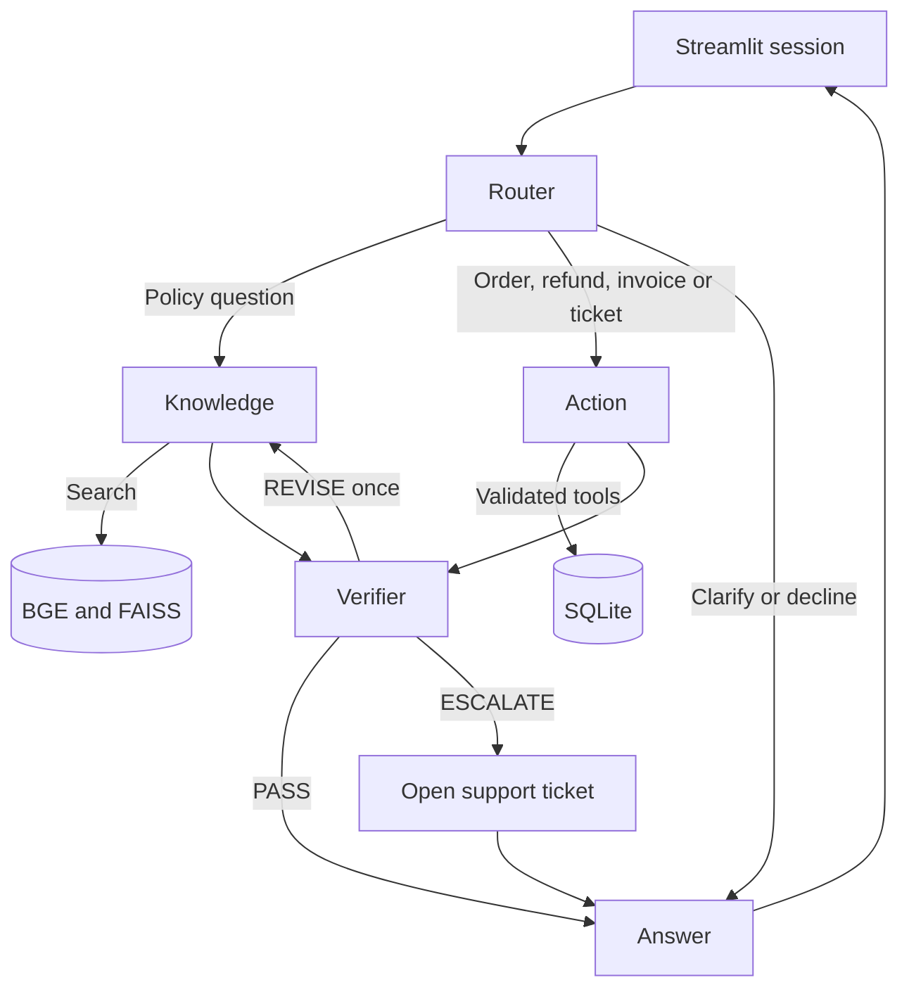
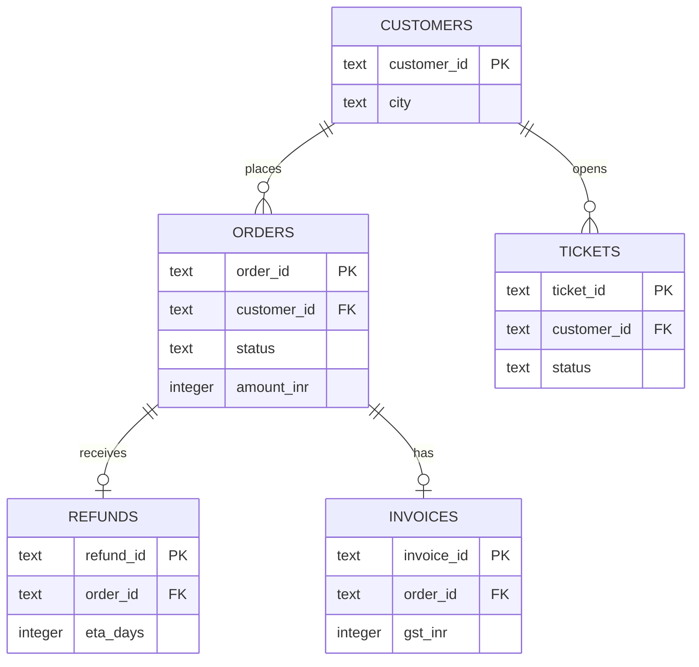

# System architecture

The Streamlit application selects a fictional customer and keeps recent turns and pending requests in that browser session. Each call to the graph has its own counters and trace. Locally written traces are under .runtime/.

A pending operation is bound to the selected customer and fixed arguments. An explicit affirmative turn can execute it. A new request clears the pending operation. Cancelling an order and creating its refund occur in the same SQLite transaction. Each order has at most one refund record.

The graph reserves a tool call for escalation. A turn is capped at six graph steps and three calls. When the Verifier rejects a policy draft, the next pass uses an approved excerpt without running retrieval or repeating a write. The no-Verifier configuration still uses the tool-layer ownership and confirmation rules.

The Router confidence is the geometric mean of the generated intent tokens' probabilities. The alternatives panel reports first-token scores. These scores are uncalibrated and can be shared by intents with the same first token. The regex slot handler recognises order and refund IDs and explicitly supplied addresses and refund reasons.
